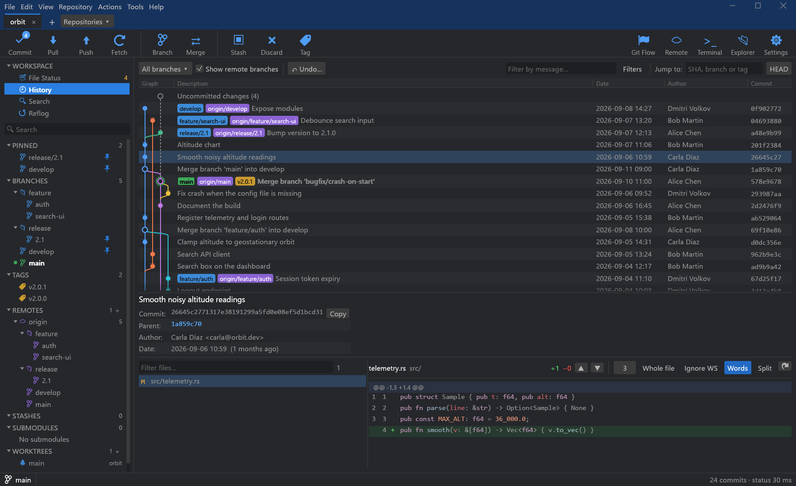
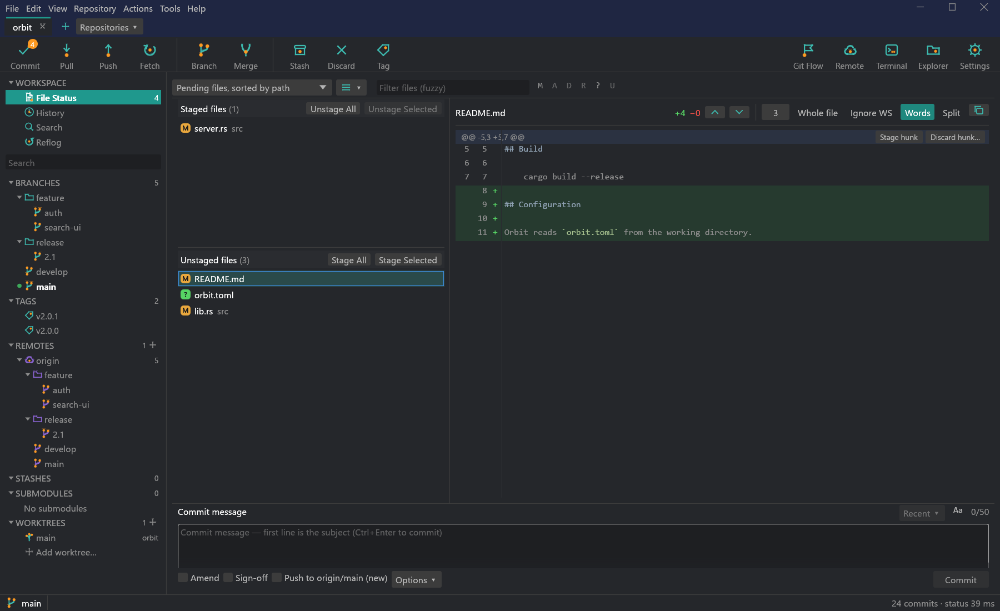
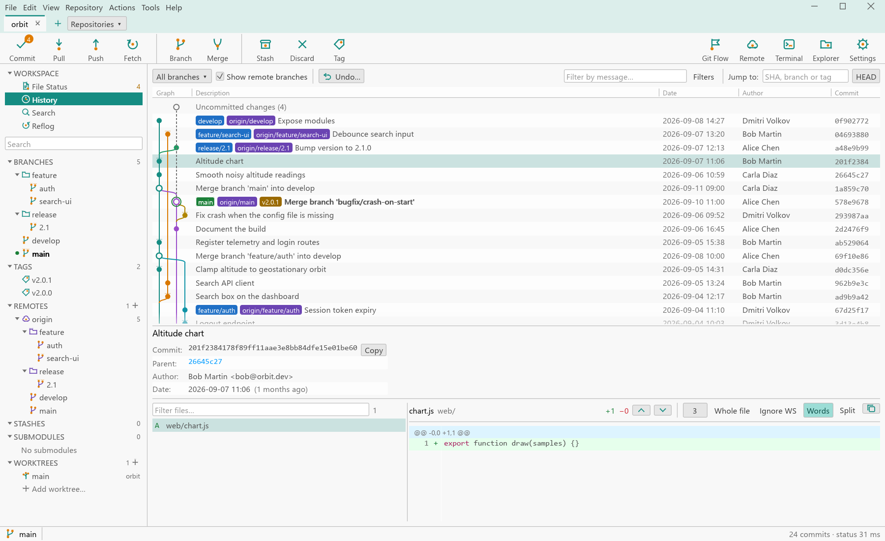
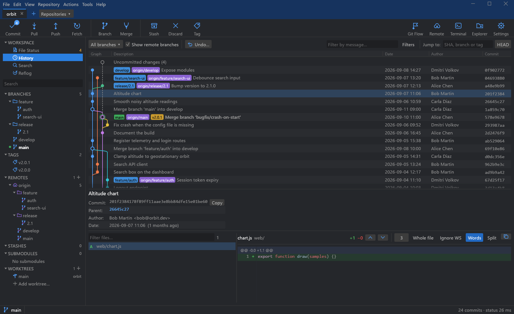
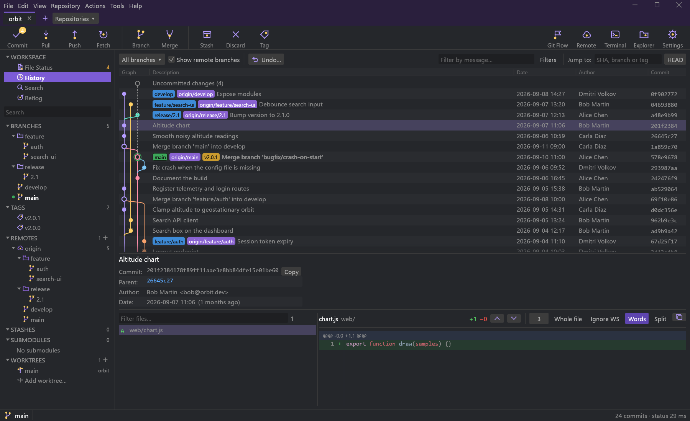

<p align="center"></p>

# GitKwaken

A fast, lightweight, SourceTree-style git client for Windows, written in Rust.

GitKwaken gives you the familiar SourceTree workflow (commit graph, staging, branches, stashes,
remotes, tabs) but starts instantly and stays smooth on huge repositories. The UI is
[egui](https://github.com/emilk/egui) rendered directly with Direct3D 11; all git work happens on
background threads, so the UI never blocks on the repository.

> **AI-generated code.** Everything in this repository — source code, tests, scripts,
> installers, CI workflows and documentation — was written by an AI model (Anthropic's
> Claude, through Claude Code), directed and reviewed by a human. The logo
> (`assets/logo.png`) was supplied by the project owner. No code was
> copied from other projects; third-party code is used only as normal dependencies under their
> own licenses (see [Third-party software](#third-party-software)).

> Status: 1.0.5. Windows is the primary target. Linux x86_64 releases use an `eframe`/wgpu
> renderer instead of Direct3D (launch-tested in CI under Xvfb on Ubuntu and Arch; see
> [Linux](#linux-x86_64)). macOS builds through the same fallback but is only compile-checked.



<p>
  
  
</p>

## Features

SourceTree parity, roughly grouped the way SourceTree does it:

- **Repositories & tabs**: open / clone / create repositories, multiple repos in tabs, bookmarks,
  welcome page with recent repositories, "Open in GitKwaken" folder context menu (installer).
- **File status**: staged / unstaged lists (flat or tree), stage / unstage / discard whole files,
  hunks or individual lines, commit with amend, sign-off and GPG signing, commit-message history,
  apply / create patch.
- **History**: commit graph with lanes for all branches, filter by branch, search by message,
  author, hash or path, commit details, file history, blame.
- **Diffs**: side-by-side and unified, intra-line (word) highlighting, whitespace options, image
  and binary detection.
- **Branches & tags**: create, checkout (incl. remote tracking), rename, delete local / remote,
  set upstream, merge, rebase, interactive rebase (reorder / squash / fixup / reword / drop),
  cherry-pick, revert, reset (soft / mixed / hard), tags (create, push, delete).
- **Remotes**: fetch, pull (merge or rebase), push (incl. tags, force-with-lease), add / edit /
  remove remotes, credential and SSH passphrase prompts handled in the GUI (askpass).
- **Stashes**: stash (incl. untracked / keep index), apply, pop, drop, branch from stash.
- **Advanced**: submodules, worktrees, git-flow, LFS, bisect, sparse checkout, clean, repository
  optimization, archive export, built-in git console with a log of every executed command,
  command palette.
- **Layout**: SourceTree's window: menu bar (File, Edit, View, Repository, Actions, Tools, Help)
  that is also the title bar on Windows, repository tabs, large-icon toolbar, sidebar with
  WORKSPACE (File Status, History, Search), PINNED branches, then branches, tags, remotes,
  stashes and submodules. Pin and history-filter buttons next to each branch.
- **App**: dark / light themes, persistent window and per-repository layout, self-updater
  (Windows, Linux) that shows the release's changelog before installing, SHA-256-verified
  downloads, per-user installer or portable zip.

## Performance

Measured on a Ryzen-class desktop, Windows 11, NVMe SSD (see `crates/gk-bench`):

| Scenario | Result |
|---|---|
| Working-tree status, 200k-file repository (git CLI engine) | **75 ms** |
| History build, git.git (85k commits, with commit-graph) | **95 ms** |
| Graph layout memory, git.git | **1.7 MB** |
| DX11 renderer, 1M-row list, vsync | **117 FPS** (display-limited) |
| DX11 renderer, 1M-row list, unlocked | **> 900 FPS** |

The UI thread never runs git: it renders immutable snapshots published by background threads and
only materializes visible rows, so list and graph cost is independent of repository size.

## Installing

Grab a release from the Releases page. Windows:

- `GitKwaken-<ver>-x64-setup.exe`: per-user installer (no admin rights), Start-menu entry,
  optional desktop icon and "Open in GitKwaken" folder context menu; upgrades in place.
- `GitKwaken-<ver>-x64.msi`: the same per-user install as an MSI (for Intune/GPO-style
  deployment or `msiexec /i GitKwaken-<ver>-x64.msi /qn`); installs to
  `%LOCALAPPDATA%\Programs\GitKwaken`, newer MSIs upgrade it (one Add/Remove Programs entry).
  Features: `ContextMenu` (on by default) and `DesktopShortcut` (off), e.g.
  `msiexec /i ... ADDLOCAL=Main,DesktopShortcut`. Use either the MSI or the setup.exe, not
  both (they share the folder). The Explorer entries (context menu, `Win+R gitkwaken`) are
  written by `gitkwaken.exe` itself during the install; if the installer environment drops
  those writes (seen on a Windows 11 Insider build, 26300), the app re-creates them on its
  first start, and an uninstall may then leave them behind — remove them with
  `gitkwaken.exe --unregister-shell-integration` before uninstalling, or with the
  setup.exe installer, which is not affected.
- `GitKwaken-<ver>-x64.zip`: portable build; unzip anywhere and run `gitkwaken.exe`.

The built-in updater replaces `gitkwaken.exe` in place, which works for the zip and the
per-user installs (MSI, default setup.exe); an all-users setup.exe install under Program Files
is not writable for it. Add/Remove Programs keeps showing the installed version until the next
installer run.

Requirements: Windows 10 1809+ x64 and [Git for Windows](https://git-scm.com/download/win)
(GitKwaken drives the system `git`; a custom path can be set in Settings).

### Linux (x86_64)

- `GitKwaken-<ver>-x86_64-linux.tar.gz`: the `gitkwaken` binary with a desktop entry, icons
  and license files. Built on Ubuntu 22.04, so it runs on glibc 2.35 or newer (Arch, Manjaro,
  Fedora, Debian 12, Ubuntu 22.04+). Unpack and run `./gitkwaken [repo...]`; it needs `git` on
  `PATH`, X11 or Wayland, and a Vulkan or OpenGL driver (Mesa is enough).
- `PKGBUILD` (Arch Linux, Manjaro): installs that tarball as the `gitkwaken-bin` package,
  with the menu entry and icons. Download the release's `PKGBUILD` into an empty folder, then:

  ```sh
  sudo pacman -S --needed base-devel   # once
  makepkg -si
  ```

  makepkg downloads the tarball of the same release, checks it against the checksum pinned in
  the `PKGBUILD` and installs the dependencies (a tarball already next to the `PKGBUILD` is used
  instead of downloading). Uninstall with `sudo pacman -R gitkwaken-bin`. The template in the
  repository (`packaging/arch/PKGBUILD`) has no pinned checksum.
- `gitkwaken-bin-<ver>-1-x86_64.pkg.tar.zst`: the same package already built from that
  `PKGBUILD`; `sudo pacman -U gitkwaken-bin-*.pkg.tar.zst` installs it without makepkg.

Self-update on Linux: GitKwaken checks the latest release at startup and every 6 hours and
offers the new version in the tab bar and in Help. A pacman install (`/usr/bin/gitkwaken`)
downloads the release's package, verifies its SHA-256 and installs it with
`pkexec pacman -U` (the system asks for the administrator password); an install from the
tarball replaces its `gitkwaken` file when GitKwaken closes (the folder must be writable).

Without the PKGBUILD, a per-user desktop entry from the unpacked tarball:

```sh
install -Dm755 gitkwaken ~/.local/bin/gitkwaken
install -Dm644 gitkwaken.desktop ~/.local/share/applications/gitkwaken.desktop
cp -r icons ~/.local/share/
```

Limits on Linux:

- Windows-only features are absent: Explorer integration (folder context menu, App Paths,
  `--register-shell-integration`), the antivirus (Defender) exclusion hints in Diagnostics,
  the bundled-MinGit build, and the Direct3D renderer's test hooks used by the E2E suites.
- Open/save dialogs go through the XDG desktop portal (`xdg-desktop-portal` plus a backend
  such as `-gtk` or `-kde`), with `zenity` as the fallback and for message boxes.
- The Terminal button uses Settings › Terminal, else `$TERMINAL`, else the first of
  `x-terminal-emulator`, `kgx`, `gnome-terminal`, `konsole`, `xfce4-terminal`, … that starts.
- CI checks that the release build starts, renders a repository and exits cleanly, under Xvfb
  with Mesa software rendering on Ubuntu 22.04 and on Arch Linux (installed through the
  PKGBUILD). It has not had the hands-on testing the Windows build has had; please report
  problems with your desktop (GNOME/KDE, X11/Wayland) and GPU driver.

## Styles

Settings › General › Style picks the look: colors (dark and light variant), icons and history
graph lanes.

- **Kwak** (default): after the logo, a frog whose tentacles form a git graph. Teal line icons
  with orange commit nodes, the logo's navy title bar, teal selection.
- **Classic**: the original SourceTree-like blue, with single-color icons.

<p>
  
  
</p>

**Your own style** is a TOML file in the `styles` folder of the config directory
(`%APPDATA%\GitKwaken\styles` on Windows, `~/.config/gitkwaken/styles` on Linux). It only
needs the keys it changes; the rest comes from Kwak, or from the style named in `inherits`:

```toml
name = "Midnight"
inherits = "Kwak"     # optional

[icons]
width = 1.8           # stroke width on the 24-unit icon grid
nodes = true          # orange commit nodes (false: one color)

[icons.files]         # replace single icons with your own SVGs (paths next to this file)
commit = "lines/commit.svg"
branch = "lines/branch.svg"

[dark]
chrome = "#2A1F3D"    # title bar
accent = "#7C5CD6"    # selected sidebar row
icon = "#B49BFF"
node = "#FFD166"
lanes = ["#B49BFF", "#FFD166", "#5EE6C8", "#FF8FAB"]

[light]
accent = "#5E45B0"
```

*New style from this one* (next to the Style list) writes the selected style to that folder as a
complete file with every key, opens it and selects it; [`assets/styles/kwak.toml`](assets/styles/kwak.toml)
documents each key. While a style of yours is selected, saving its file applies it right away.
Mistakes (an unknown key, a malformed color) are shown in the Style list and the app keeps using
Kwak. `GITKWAKEN_ICON_SHEET=1` starts GitKwaken on a sheet of every icon in the selected style.

**Icons** can be replaced one by one with SVG files. *Export icons* (next to the Style list)
writes every icon of the selected style as `<name>.svg` into `styles/<style> icons/`, plus an
`icons.toml` with the matching `[icons.files]` lines: edit the SVGs you want to change in any
vector editor and paste those lines into your style. Icons are line art in the style's icon
color, like [Lucide](https://lucide.dev) / Feather icons (24×24 `viewBox`,
`stroke="currentColor"`), which work as they are. Supported: `path`, `line`, `polyline`,
`polygon`, `circle`, `ellipse`, `rect` and `g`, with `stroke`, `fill` and `stroke-width`;
parts with `class="node"` take the style's node color. Not supported: `transform`, gradients,
text and images (the Style list then reports the file as an error).

## Updates and going back

GitKwaken checks the latest GitHub release at startup and every 6 hours. A newer one shows a
button in the tab bar (and Help › Install update): it opens the release's changelog with
*Install update*, *Not now* and *Skip this version*.

- **Install another version** (Help): lists every release with its changelog; any of them can
  be installed, older ones included, e.g. to go back after an update that went wrong. Going
  back can also skip the newer release so it is not offered again.
- **Withdrawing a bad release** (maintainers): run the *Withdraw release* workflow
  (Actions › Withdraw release) with the version and a reason. The release is marked
  "(withdrawn)" and as a pre-release, and the update channel goes back to the newest good
  release, so nobody is offered the bad one any more. Installations already running it
  (1.0.4 and later) show *⚠ Roll back to &lt;good version&gt;* with the reason. Running the
  workflow with *restore* undoes it.

Release notes come from [CHANGELOG.md](CHANGELOG.md): the release workflow copies the
`## <version>` section into the update channel and the GitHub release.

## Building

```sh
# Rust stable (edition 2024), MSVC toolchain on Windows
cargo build --release -p gk-app        # -> target/release/gitkwaken.exe
cargo run -p gk-app -- path/to/repo    # open a repository directly
cargo test --workspace
```

Linux needs the usual eframe/GTK development packages:

```sh
sudo apt-get install libxkbcommon-dev libgtk-3-dev libxcb-render0-dev libxcb-shape0-dev \
                     libxcb-xfixes0-dev libssl-dev
```

(Arch/Manjaro: `rust` and `base-devel`; winit and wgpu load the system libraries at run time.)
The Linux release package and its launch test, as CI runs them (`packaging/linux-ci-deps.sh`
lists the Ubuntu packages, including `pwsh` and ImageMagick for packaging):

```sh
bash packaging/build-linux.sh       # -> dist/GitKwaken-<ver>-x86_64-linux.tar.gz, dist/PKGBUILD
bash scripts/linux-smoke.sh target/x86_64-unknown-linux-gnu/release/gitkwaken
```

Release packaging (zip, `update.json`, the Inno Setup installer if Inno Setup 6 is installed,
and the MSI if the WiX CLI is installed):

```powershell
dotnet tool install --global wix --version 6.0.2   # once, for the MSI (packaging/wix/gitkwaken.wxs)
powershell -ExecutionPolicy Bypass -File packaging\build-release.ps1
```

[cargo-dist](https://github.com/axodotdev/cargo-dist) 0.33.0 is configured in
`dist-workspace.toml` as an alternative build of the zip: `dist plan`,
`dist build --artifacts=local` (output in `target/distrib`). The release workflow does not use
it; see `docs/ARCHITECTURE.md` (Packaging).

The app icons (`assets/icon.ico`, `icon-256.png`, `icon-1024.png`) are generated from the
raster logo `assets/logo.png` with
`cargo run --release --manifest-path packaging/icongen/Cargo.toml`: the logo's tile is fitted
into a rounded square (8/256 margin, 52/240 corner radius) and everything around it becomes
transparent.

## Keyboard shortcuts

| Shortcut | Action |
|---|---|
| `Ctrl+O` | Open repository |
| `Ctrl+W` | Close tab |
| `Ctrl+Tab` | Next tab |
| `F5` | Refresh |
| `Ctrl+1` / `Ctrl+2` / `Ctrl+3` | File status / History / Search view |
| `Ctrl+Enter` | Commit (in the commit message box) |

## Architecture

A Cargo workspace; the GUI crate is thin and everything git-related is testable without a window.

| Crate | Role |
|---|---|
| `gk-cli` | Runs the system `git`: blocking and streaming calls, progress parsing, cancellation (job objects on Windows), global command log. |
| `gk-status` | Working-tree status model, two engines (in-process gitoxide and git CLI), incremental merging, debounced file-system watcher. |
| `gk-graph` | Commit-graph layout: date-ordered topological sort and lane assignment on dense `u32` indices. |
| `gk-diff` | Display diffs, intra-line highlighting, partial patches and line-level stage / unstage / discard. |
| `gk-core` | Repository model and orchestration: refs, history, diffs, operations, and the background `Session` the UI talks to. |
| `gk-settings` | Persistent app settings and per-repository UI state (TOML in `%APPDATA%\GitKwaken`). |
| `gk-askpass` | Credential / passphrase / host-key prompts from git and ssh routed to the GUI over loopback. |
| `gk-dx11` | Runs an egui app in a native window rendered with Direct3D 11 (eframe fallback elsewhere). |
| `gk-update` | Self-update: channel manifest check, SHA-256-verified download, exe self-replace (Windows zip, Linux tarball) or `pkexec pacman -U`. |
| `gk-app` | The `gitkwaken` executable: views, dialogs, tabs. |
| `gk-bench` | Benchmarks for status, history and graph on real repositories. |

See [docs/ARCHITECTURE.md](docs/ARCHITECTURE.md) for the threading model.

## License

Licensed under either of

- Apache License, Version 2.0 ([LICENSE-APACHE](LICENSE-APACHE))
- MIT license ([LICENSE-MIT](LICENSE-MIT))

at your option. Unless you explicitly state otherwise, any contribution intentionally submitted
for inclusion in the work by you, as defined in the Apache-2.0 license, shall be dual licensed as
above, without any additional terms or conditions.

The code is AI-generated (see the note at the top). In some jurisdictions purely
machine-generated material may not be eligible for copyright; the licenses above apply to
whatever rights exist in it and, either way, grant you the same freedoms.

### Third-party software

GitKwaken depends on ~330 Rust crates, almost all under MIT, Apache-2.0, BSD, ISC, Zlib,
Unicode or similar permissive licenses; a few are MPL-2.0 (`nucleo-matcher`, `option-ext`,
`uluru`, used unmodified) or CDLA-Permissive-2.0 (`webpki-roots`), and `self_cell` is used
under Apache-2.0. The executable also embeds the egui default fonts (Ubuntu Font Licence 1.0,
SIL OFL 1.1, MIT) and syntect's syntax definitions and themes (Sublime HQ packages license,
MIT). Release packages ship all notices in `THIRD-PARTY-LICENSES.txt`, generated by
[`scripts/third-party-licenses.ps1`](scripts/third-party-licenses.ps1). Builds with a bundled
MinGit (`-BundleGit`) also contain Git for Windows under the GNU GPL v2 with its own license
files; its source is at <https://github.com/git-for-windows/git>.

### Trademarks

GitKwaken is an independent project, not affiliated with or endorsed by Atlassian (SourceTree),
Fork, GitKraken, SourceGit or GitHub. Product names are used only to describe the design goal
and to report benchmark comparisons; all trademarks belong to their owners.
